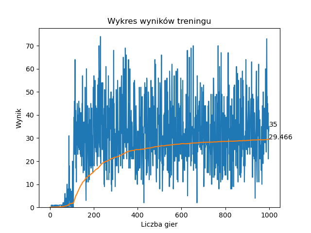
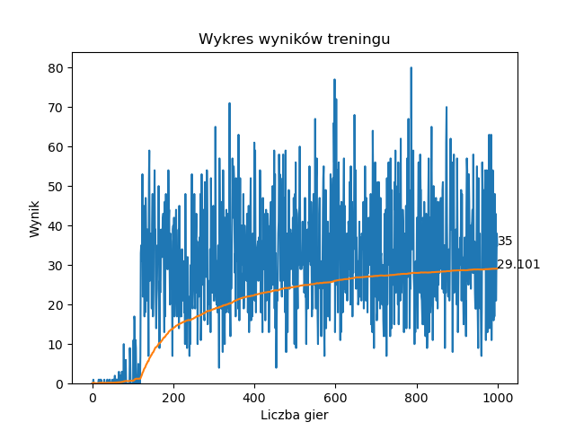

# Snake DQN

> Snake agent trained with Deep Q-Learning, comparing a linear Q-network with a deeper DQN.

## Run

```bash
pip install -r requirements.txt
python agent.py
```

Trains both models (`Linear_QNet`, `DQN`) and plots score per game. Trained weights are in `model/`.

## Results

Both agents trained for 1000 games (orange line: running mean score).

| Model | Mean score after 1000 games |
|---|---|
| `Linear_QNet` (1 hidden layer) | 29.5 |
| `DQN` (deeper network) | 29.1 |

| Linear Q-network | DQN |
|---|---|
|  |  |

The deeper network does not improve on the linear one: with an 11-feature state the task is simple enough that extra capacity does not help.

## Credits

The game environment and training loop are based on [patrickloeber/snake-ai-pytorch](https://github.com/patrickloeber/snake-ai-pytorch). The `DQN` model variant and the model comparison are my additions.

---

Built as coursework for Applied Computer Science at Warsaw University of Technology.
